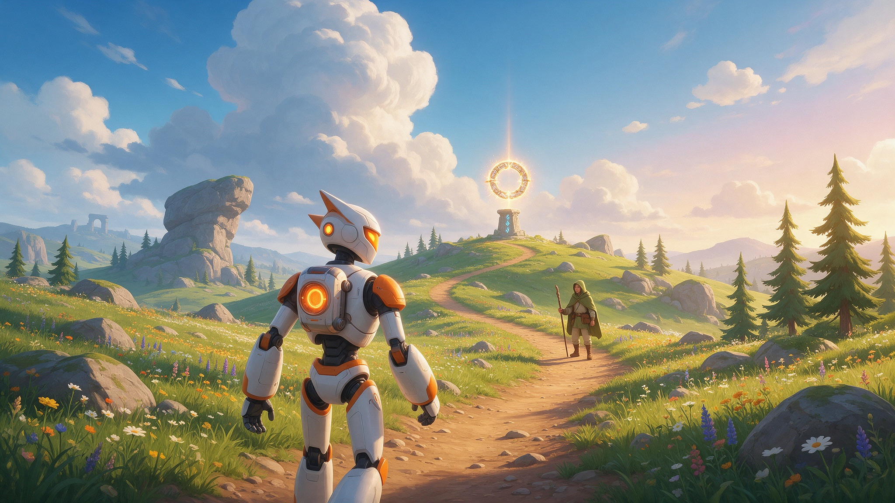

# 3D Open World Explore TPS Template

A third-person adventure slice: walk an animated robot hero across open terrain, talk to an NPC, find the relic and fill your inventory.

Use it as a foundation for exploration games, action-adventure prototypes, survival-lite worlds, quest hubs, or any project that needs ready third-person movement and interaction.

## What's inside

- Third-person character controller with walking, sprinting, jumping, coyote time and jump buffering.
- Mouse and gamepad orbit camera with spring-arm collision.
- Generated terrain with roads, flat pads and placed open-world landmarks.
- A patrolling, interactable NPC and a collectible relic quest.
- HUD with interaction prompts, mission text and an inventory overlay.
- Rigged robot hero with locomotion clips, plus tool scripts to rebuild, inspect and verify the scene.

## Get started

1. [Download the ZIP](https://github.com/SummerEngine/template-3d-open-world-explore-tps/archive/refs/heads/main.zip) or clone the repo:
   `git clone https://github.com/SummerEngine/template-3d-open-world-explore-tps.git`
2. Open the folder in [Summer Engine](https://www.summerengine.com/download).
3. Press Play.

Summer's AI agent can extend it for you. Try asking:

- "Add three more relics hidden around the map and a quest log that tracks them."
- "Add a day and night cycle with stars at night."
- "Give the NPC a dialogue tree with two choices that change the quest reward."

## Controls

| Action | Keyboard / Mouse |
| --- | --- |
| Move | `W` `A` `S` `D` |
| Look / orbit camera | Mouse movement |
| Sprint | `Shift` |
| Jump | `Space` |
| Interact | `E` |
| Inventory | `I` |
| Release mouse | `Esc` |
| Recapture mouse | Click in the game window |

Gamepad camera orbit is on the right stick through the `camera_left`, `camera_right`, `camera_up` and `camera_down` actions.

## Building on it

Start from `scenes/main.tscn` and the gameplay scripts in `scripts/`:

- `scripts/third_person_controller.gd`: movement, jumping, sprinting and interaction.
- `scripts/third_person_camera.gd`: camera feel, follow distance, pitch limits and sensitivity.
- `scripts/adventure_interactable.gd` and `scripts/adventure_collectible.gd`: new interactable objects.
- `scripts/adventure_quest_state.gd`: the sample NPC and relic quest.
- `scripts/adventure_hud.gd`: mission text, inventory UI, prompts and tooltips.
- `tools/build_main_scene.gd`: regenerates the main scene structure after you change template content.

## Credits

Asset source and license notes live in [`asset_manifest/third_person_adventure_assets.md`](asset_manifest/third_person_adventure_assets.md). Review and complete those notes before shipping a public game built from this template.
